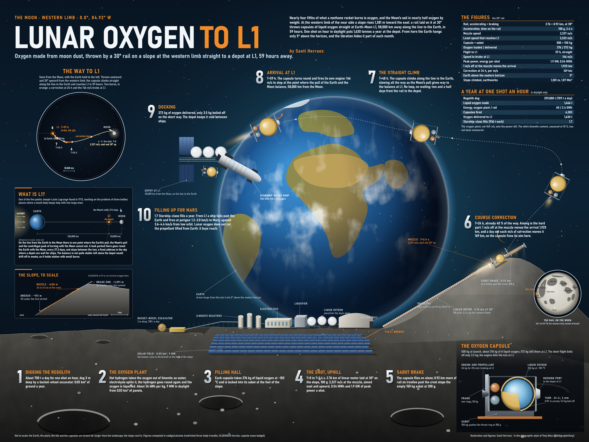
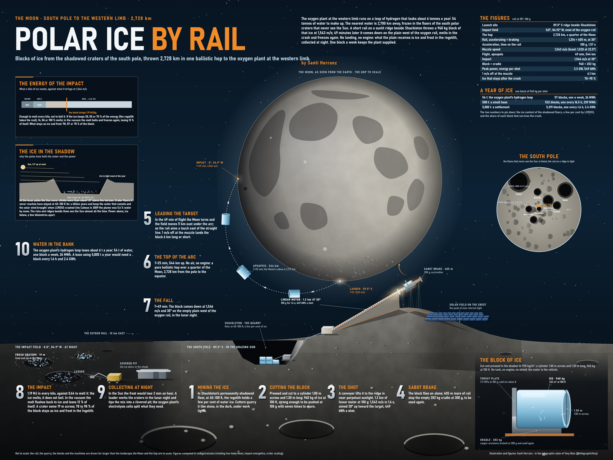

# Lunar launchers by Santi Herranz

Rail launchers on the Moon. An electromagnetic rail (a mass driver) runs on solar power and needs no propellant. On the Moon there is no air, and escape speed is only 2.38 km/s, so a rail a few kilometres long is enough to throw payloads into orbit or across the surface.

This repository has four pieces of the same lunar supply chain:

| | Piece | What it does |
|---|---|---|
| 1 | [**Lunar oxygen to L1, direct route**](oxygen-to-l1-direct/) (main version) | Oxygen is extracted from the regolith at the equator, liquefied, and fired in 500 kg capsules from a rail inclined 30° up a hillside on the western limb (84.92°W). They fly straight to the Earth–Moon L1 point in 59 h. A depot there refuels ships bound for Mars. |
| 2 | [**Lunar oxygen to L1, flat rail**](oxygen-to-l1/) | The first design: a flat rail at the centre of the near side. Its capsules loop once around the Moon and take 308 h. This folder also holds the calculation model shared by both routes. |
| 3 | [**Polar ice hop**](polar-ice-hop/) | A rail on a sunlit ridge at the south pole throws blocks of ice cut from permanently shadowed craters on a 2,728 km ballistic arc. They come down beside the direct oxygen rail and resupply its plant with water. |
| 4 | [**L1 Oxygen Run**](game/), a game | One button. Fire a capsule at the right speed and see whether it reaches the depot at L1, from the hillside rail or the flat one. **[Play it in your browser](https://santiherranz.github.io/lunar-launchers/game/)** |

## Key numbers

| | Oxygen to L1, direct route | Oxygen to L1, flat rail | Polar ice hop |
|---|---|---|---|
| Site | 0.0°, 84.92°W, rail at 30° on a 1,381 m slope | 2.75°N 14.25°W | −89.5°, 0° (near Shackleton) → 0.0°, 84.92°W |
| Launch speed | 2,327.3 m/s | 2,328.2 m/s | 1,543 m/s |
| Rail | 2.76 km at 100 g, inclined 30° | 2.76 km at 100 g | 1.2 km at 100 g |
| Flight | 59 h, direct | 308 h, with one loop around the Moon | 49 min, ballistic |
| Payload | 372 kg of liquid oxygen delivered | 356 kg of liquid oxygen delivered | 940 kg ice block, impacts at 1,546 m/s |
| Aim | 1,925 km per m/s, corrected at T+24 h | 5,730 km per m/s, corrected at T+24 h | 6.1 km per m/s of error |

## What's inside

Each folder has its own README with the reference figures, the main findings and how to rerun the calculations.

- `*/calculations/`: the Python models (NumPy and SciPy). Each script writes its `.json` or `.log` next to it, and the outputs committed here are the reference runs. **Script names, comments and output keys are in Spanish**, the language the work was done in. The READMEs explain each script in English.
- `*/plates/`: the illustrated plates, drawn entirely in code. Only the rendered images are published, not the drawing engine.
- `game/index.html`: a single self-contained page with no build step.

## Licence

Code: [MIT](LICENSE). Plates and illustrations: [CC BY 4.0](LICENSE-images.md). Please credit Santi Herranz.
