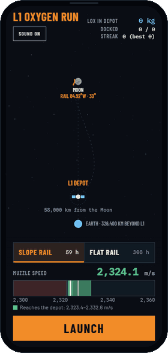

# L1 Oxygen Run by Santi Herranz

**[Play it in your browser](https://santiherranz.github.io/lunar-launchers/game/)**, or in a phone frame on the [project's home page](https://santiherranz.github.io/lunar-launchers/).

<p align="center"></p>

A one-button game built on the physics of [Lunar oxygen to L1](../oxygen-to-l1-direct/). A needle sweeps between 2,300 and 2,360 m/s. Press **LAUNCH** or the space bar to fire a capsule of liquid oxygen from the rail. Then watch whether it reaches the depot at L1.

## Two rails

A selector chooses the launch site. The game opens on the hillside rail, the [direct route](../oxygen-to-l1-direct/) and the main version, and remembers your choice after that.

| | Hillside rail | [Flat rail](../oxygen-to-l1/) |
|---|---|---|
| Site | 0.0°, 84.92°W, on the western limb | 2.75°N 14.25°W, near the centre of the near side |
| Rail | inclined 30° up a 1,381 m slope | flat, firing east |
| Route | direct, 59 h | one loop around the Moon, 308 h |
| Delivery window | 2,323.4–2,332.6 m/s | 2,323.6–2,332.9 m/s |
| Oxygen delivered | 372 kg | 356 kg |
| Capsule Δv budget | 215.6 m/s | 228.8 m/s |

## How a shot is judged

The flight is integrated in real time with the circular restricted three-body problem (Earth, Moon and capsule, in the rotating frame), the same model as `l1_transferencia.py`. At T+24 h the capsule makes one correction burn along its velocity, aimed with a secant search at the crossing of L1's plane. It delivers if the correction, braking at L1 and the 20 m/s for docking all fit its budget (from `capsula_l1.py`, sized for each route).

The direct route misses three times less per m/s of error. But by T+24 h it has already flown 40 % of its trip, so the correction costs the same on both rails, about 11 m/s for every m/s of muzzle error, and the windows come out equally wide. A shot 1 m/s too fast with no correction would hit the Moon on the flat rail's close pass.

## Details

- On screens of 1000×620 or more, an inset at the bottom right shows the chosen rail in profile and to scale, as if through a telescope. The terrain comes from `perfil_railes.py`, and the circle spans 4.5 km for both rails.
- When you press, a marker pins the exact speed on the gauge: it slams in white, sends a shockwave both ways and shows the speed. It is green inside the window, red below the minimum and orange above. Only one capsule flies at a time, so the needle stops under the marker and the rest of the strip dims, leaving the trajectory as the focus. When the shot is resolved, the marker fades and the needle sweeps on.
- The T+24 h burn is sized to the correction, like a real engine at constant thrust: it fires for 0.3 s plus 0.045 s per m/s. A 3 m/s fix is a short puff of 0.4 s; a 57 m/s fix roars for almost 3 s. The plume, the gas trail, the shake and the sound grow with it, and the label counts the m/s up as they are applied.
- The launch plays in real time: 2.4 s at 100 g, then the cradle brakes over 0.92 km. The map waits at T+0 until the capsule leaves the circle.
- On phones there is no room for the inset, so the spyglass pops up over the map for the shot and the rest of the screen darkens, as if you put your eye to it. It shrinks away once the capsule has left the circle. The controls fit in less space: one line per rail, and only the delivery window in the legend.
- The shot fires when your finger or mouse button goes down, not when it lifts: in a timing game the ~100 ms of a click would move the needle. Phones that can vibrate buzz on the launch, the release, the burn, docking and impact, with the same switch as the sound.- All sounds are synthesised with Web Audio, with no audio files: the rail's hum rising with speed, the release, the correction engine with its plume (forward when braking, backward when accelerating; a perfect shot needs no burn), docking, impact and failure. Press **M** or the sound button to mute.
- Screen shake, sparks, rings and flashes mark the key moments. They are turned off when the system asks for reduced motion.

## Running it locally

`index.html` is a single self-contained file. Open it with a double click, or serve the folder:

```bash
python -m http.server
```

It loads its fonts (Barlow, Barlow Condensed, IBM Plex Mono) from Google Fonts and falls back to system fonts offline.
