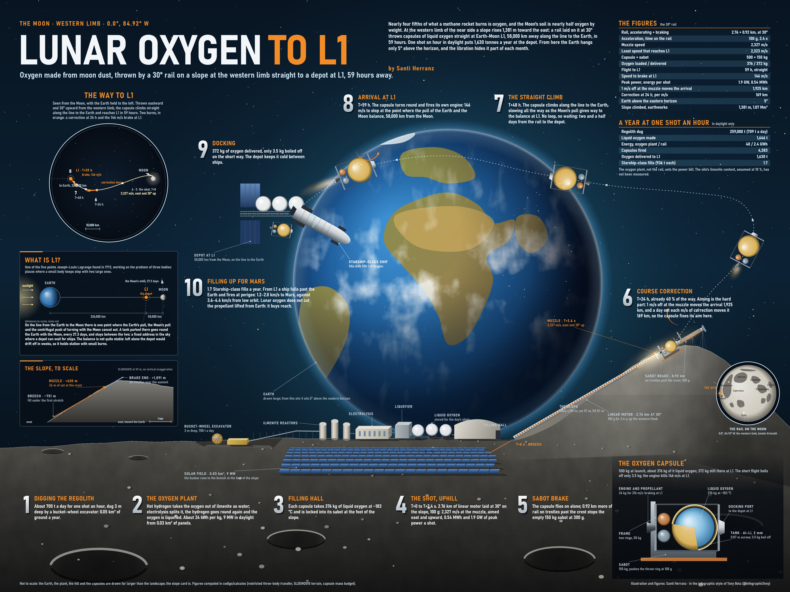

# Lunar oxygen to L1, direct route by Santi Herranz

**The main version of the oxygen launcher.** An electromagnetic rail inclined at 30° climbs a 1,381 m hillside on the Moon's equator at 84.92°W, on the western edge of the near side. It fires 500 kg capsules of liquid oxygen straight to L1, the Earth–Moon Lagrange point 58,000 km from the Moon, where a depot refuels ships bound for Mars. The trip takes 59 h. The capsules don't loop around the Moon first, as they do from the [flat rail](../oxygen-to-l1/) at the centre of the near side.



## Reference figures

| Item | Value |
|---|---|
| Site | 0.0°, 84.92°W, a slope on the western limb |
| Rail | 2.76 km of acceleration at 100 g + 0.92 km to brake the cradle, inclined 30° and firing east |
| On the slope | the rail runs from −751 m to +630 m; the cradle brake continues on trestles up to +1,091 m, above the 944 m crest; 1.07 million m³ of earthworks (cuts up to 57 m, fills up to 87 m) |
| Muzzle speed | 2,327.3 m/s (the minimum that reaches L1 is 2,322.8 m/s) |
| Flight to L1 | 59.2 h, direct |
| Speed the capsule must shed at L1 | 145.8 m/s, with its own engine |
| Oxygen per 500 kg capsule | 375 kg loaded, 372 kg delivered (3.5 kg boils off on the way) |
| Capsule Δv budget | 215.6 m/s: course correction, braking at L1 and 20 m/s for docking |
| One shot per hour, daytime only | 1,646 t of oxygen a year; 1,630 t reach L1 (1.7 Starship refills) |
| Aim | 1 m/s at the muzzle = 1,925 km at L1; 1° of elevation = 1,102 km; 1° of azimuth = 619 km |
| Course correction | 1 m/s at T+24 h moves the arrival 169 km (337 km at T+12 h) |
| Delivery window | 2,323.4–2,332.6 m/s, with the correction made at T+24 h |

## Direct versus flat rail

| | Direct (this route) | [Flat rail](../oxygen-to-l1/) |
|---|---|---|
| Site | 0.0°, 84.92°W, on a slope | 2.75°N 14.25°W, on a plain |
| Rail | inclined 30° | flat |
| Earthworks | 1.07 million m³ | 0.27 million m³ |
| Flight | 59 h, direct | 308 h, one loop around the Moon |
| Braking at L1 | 146 m/s | 158 m/s |
| Delivered per capsule | 372 kg | 356 kg |
| Boil-off on the way | 3.5 kg | 17.9 kg |
| Arrival shift per m/s of muzzle error | 1,925 km | 5,730 km |
| Close pass by the Moon | none | 1,250 km above the surface at 255.8 h |
| Earth seen from the site | about 5° above the horizon, hidden by libration part of every month | high in the sky |

## Why it is the main version

- **Five times faster.** It arrives in 59 h instead of 308 h, with no grazing pass by the Moon on the way. Less oxygen boils off, and each capsule delivers 16 kg more.
- **Three times less sensitive to aim.** An error at the muzzle grows less along a direct path. The correction still has to be made at T+24 h, though. By then the capsule has flown 40 % of its trip, so fixing it costs about the same as on the flat rail: roughly 11 m/s for every m/s of muzzle error. The delivery window comes out as wide on both rails.
- **The price is the site.** The rail needs a slope of the right steepness, on the equator and facing east. The earthworks are four times larger than on the flat rail. And from the western limb, Earth sits low on the horizon and libration hides it for part of the month, which matters for tracking and communications.
- **A neighbour.** The [polar ice hop](../polar-ice-hop/) aims its blocks at the plain right beside this site, to resupply the oxygen plant with water.

## How the site was found

`sitio_l1_directo.py` searched for slopes of 20–45° between 105°W and 45°W, fitted a straight inclined rail to the real terrain (SLDEM2015, LOLA + Kaguya, 59 m per pixel) and integrated the flight to L1 for the 40 fits needing the least earthworks. 16 of them reach L1, and the slope at 84.92°W with a 30° rail is the only one that combines three things:

- **A slow arrival.** Seven of the 16 shoot through in 13–17 h, but then arrive at 800–1,100 m/s, too fast to brake.
- **The near side.** The others that arrive slowly lie beyond the 90°W limb, where Earth is below the horizon most of the month. Some of them brake a little less, down to 133 m/s.
- **The equator.** Sites off the equator miss L1 out of plane, by up to 1,738 km, when the rail points due east. To use them, the rail would have to be turned and fitted to the terrain again.

## Running the calculations

The model is shared with the flat route: the scripts live in [`../oxygen-to-l1/calculations`](../oxygen-to-l1/calculations), and their table there explains what each one computes. The outputs specific to this route are in [`calculations/`](calculations/). The scripts write their results into the folder they are run from:

```bash
cd calculations
python ../../oxygen-to-l1/calculations/l1_transferencia.py sensibilidad -84.92 90 30 0  # this site: errors and corrections (writes l1_sensibilidad.json; saved here as l1_sensibilidad_directa.json)
python ../../oxygen-to-l1/calculations/capsula_l1.py 146 59 100                           # the capsule for this route
python ../../oxygen-to-l1/calculations/l1_transferencia.py directos                        # direct routes with an inclined rail (~5 min)
```

The slope search, `sitio_l1_directo.py`, is run in `../oxygen-to-l1/calculations`, because `perfil_railes.py` reads its result there. It downloads about 8 MB of terrain.

| File | Contents |
|---|---|
| `l1_sensibilidad_directa.json` | The reference shot from this site: v0, time, arrival speed and every sensitivity |
| `capsula_l1.json`, `capsula_l1.log` | Capsule masses for 146 m/s of braking after 59 h, with capsules from 100 kg to 1 t |
| `l1_directos.json`, `l1_directos.log` | Direct routes to L1 by longitude and rail inclination |
| [`../oxygen-to-l1/calculations/sitio_l1_directo.json`](../oxygen-to-l1/calculations/sitio_l1_directo.json) | The slope search and the trajectories of the best fits |

## Plate

`lunar_l1_direct.jpg` is a 4:3 poster on black, in the style of the flat-rail poster. Earth is in the centre and the depot at L1 on the left. On the right are the surface and the hillside, with the rail drawn on the real SLDEM slope profile. The 59 h path is drawn from the dense solution of the trajectory, and there's an inset of the whole Moon with the site marked next to Grimaldi. The plate is drawn entirely in code; only the rendered image is published here.
