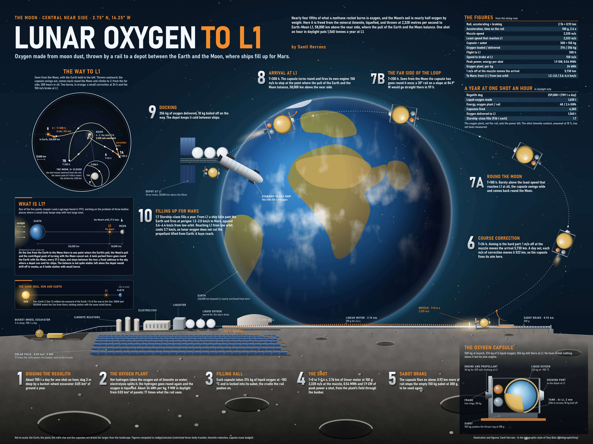

# Lunar oxygen to L1, flat rail by Santi Herranz

> This is the first design. The main version is now the [direct route](../oxygen-to-l1-direct/): a rail inclined 30° on a hillside at 84.92°W that reaches L1 in 59 h without looping around the Moon. The calculation model in [`calculations/`](calculations/) is shared by both routes, and so are the oxygen plant and the Mars figures below.

A straight electromagnetic rail near the centre of the Moon's near side (2.75°N 14.25°W) launches 500 kg capsules of liquid oxygen to L1, the Earth–Moon Lagrange point 58,000 km from the Moon. A depot at L1 stores the oxygen and refuels ships heading for Mars. The oxygen comes from the regolith: ilmenite is reduced with hydrogen, the water is split, the hydrogen goes back to the reactor and the oxygen is liquefied.



## Reference figures

| Item | Value |
|---|---|
| Rail | 2.76 km of acceleration + 0.92 km to brake the cradle; flat, firing due east |
| Muzzle speed | 2,328.2 m/s (the minimum that reaches L1 is 2,322.8 m/s) |
| Flight to L1 | 308 h, with one loop around the Moon |
| Speed the capsule must shed at L1 | 158 m/s, with its own engine |
| Oxygen per 500 kg capsule | 374 kg loaded, 356 kg delivered |
| One shot per hour, daytime only | 1,638 t of oxygen a year; 1,560 t reach L1 (1.7 Starship refills) |
| Oxygen plant | 24 kWh per kg; 9.1 MW in daylight; 709 t of regolith a day; 17 times the energy of the rail |
| To Mars from L1 / from low Earth orbit | 1.2–2.0 / 3.6–4.4 km/s |

## Findings

- **What oxygen at L1 is worth.** For a methane ship leaving low Earth orbit, climbing to L1 and carrying the methane there costs as much as the oxygen saves: 1,296 t launched from Earth against 1,200 t. What L1 oxygen buys is reach: about 2.4 km/s more after departing for Mars.
- **A better, direct route, with a site.** On the equator at 84.92°W, a rail inclined at 30° fits a slope that rises 1,381 m. From there the capsule reaches L1 directly in 59 h, sheds 146 m/s and delivers 372 kg, and the route is three times less sensitive to errors. It became the main version: see [the direct route](../oxygen-to-l1-direct/).
- **Aim.** Because of the loop around the Moon, 1 m/s of muzzle error moves the arrival 5,730 km on the flat-rail route. The correction burn has to happen at T+24 h.
- **The close pass on the loop.** The reference trajectory comes back past the Moon at 255.8 h, 1,250 km above the surface (2,987 km from the centre). Any close-approach figure must come from the dense ODE solution (`dense_output`), not from coarse samples of the path.

## Running the calculations

Requirements: Python 3 with `numpy` and `scipy`; `rasterio` for the site fitting.

```bash
cd calculations
python l1_transferencia.py prueba                       # tests: L1, Jacobi constant, minimum speed
python l1_transferencia.py barrido                      # sites x rail inclination x east/west (~12 min)
python l1_transferencia.py sensibilidad -14.25 90 0     # reference site: errors and corrections
python l1_transferencia.py trayectoria -14.25 90 0      # the path used for the plates (l1_trayectoria.json)
python capsula_l1.py 158 308 100                        # liquid-oxygen capsule mass budget
python oxigeno.py                                       # oxygen plant: regolith, energy, power
python sitio_lunar.py 100 l1                            # fit the flat rail to the real terrain (downloads ~5 MB)
python sitio_l1_directo.py                              # 20–45° slopes from 105°W to 45°W and their routes to L1 (~8 MB)
python marte.py                                         # from L1 and from low Earth orbit to Mars; propellant from Earth
python perfil_railes.py                                 # terrain profile of both rails, for the game's inset
```

The direct route's own runs (its sensitivity, its capsule and the sweep of inclined rails) are explained in [its README](../oxygen-to-l1-direct/#running-the-calculations), and their outputs are kept there.

| Script | What it computes |
|---|---|
| `constantes.py` | Earth, Moon and lunar orbit constants |
| `l1_transferencia.py` | Moon → L1 flight in the circular restricted three-body problem (rotating frame); finds launch speeds, sweeps sites, sensitivities and the correction at T+24 h |
| `capsula_l1.py` | Capsule masses: an insulated aluminium–lithium tank, engine and propellant for braking at L1 and docking |
| `oxigeno.py` | Oxygen plant: ilmenite reduction, regolith mined, energy and power (Leger et al., PNAS 2025) |
| `rampa_lunar.py` | Rail, cradle, energy, peak power, firing rate, solar panels and batteries. On its own it defaults to the speed of an earlier low-orbit version; pass `2328.2` for L1 |
| `sitio_lunar.py` | Straight rail fitted to SLDEM2015 (LOLA + Kaguya, 59 m); use mode `l1` |
| `sitio_l1_directo.py` | Search for steep slopes on the western limb that fit an inclined rail, and their trajectories to L1 |
| `marte.py` | Delta-v to Mars from L1 and from low Earth orbit; propellant launched from Earth with and without lunar oxygen |
| `perfil_railes.py` | Terrain profile along both rails |

The terrain is read through HTTP range requests from the USGS Astrogeology GeoTIFF and cached in `calculations/lola/` (not committed).

## Plates

| File | Plate |
|---|---|
| `lunar_l1_poster.jpg` | The flat-rail route as a 4:3 poster on black |
| `lunar_l1.jpg` | The flat-rail route in ink and watercolour |
| `lunar_l1_oil.jpg` | The same story as a Renaissance oil panel |
| `lunar_oxygen_concept*.jpg` | Concept illustrations of the whole chain (mine, process, liquefy, launch, refuel at L1). Scales and trajectory are schematic |

The plates are drawn entirely in code. Only the rendered images are published here. The direct route's poster is in [its own folder](../oxygen-to-l1-direct/plates/).

## Open questions

- Where the capsules come from: brought from Earth or built on the Moon.
- The plane of the arrival orbit: launch windows to reach a specific station.
- Halo-orbit insertion and station-keeping of the depot; lunar eccentricity and the Sun in the trajectory model.
