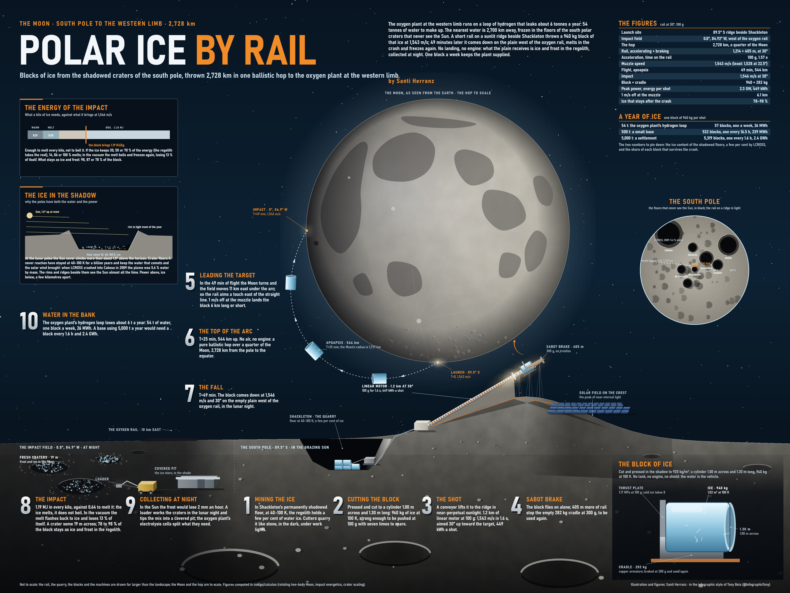

# Polar ice hop by Santi Herranz

An electromagnetic rail on a sunlit ridge at the Moon's south pole launches blocks of ice cut from permanently shadowed craters. They fly a 2,728 km ballistic arc and come down on the plain next to the oxygen rail's site (0.0°, 84.92°W, the western edge of the near side), where the water accumulates. The blocks don't land: they impact, and what is left is collected.

It started as a way to replace the hydrogen lost in the ilmenite cycle of the [oxygen plant](../oxygen-to-l1/) (about 6 t a year, which is 54 t of water), but it is sized as a system in its own right.



## Reference figures

Assumed departure at −89.5°, 0°, +1,000 m (a ridge near Shackleton); arrival at 0.0°, 84.92°W, −1,500 m. Spherical Moon, two-body, rotating.

| Item | Value |
|---|---|
| Arc | 2,728 km; the target moves 4.6 m/s east with the Moon's rotation |
| Minimum energy (Moon not rotating) | 1,528 m/s at 22.5° |
| Design point | rail at 30°, 100 g: 1,543 m/s, azimuth −84.5°, 49 min of flight, apoapsis 544 km |
| Impact | 1,546 m/s, 30° above the ground |
| Aim | 1 m/s at the muzzle = 6.1 km; 0.1° of azimuth = 3.0 km; 1° of elevation = 26 km |
| Rail | 1,214 m of acceleration in 1.57 s + 405 m to brake the cradle at 300 g |
| Block | ice cylinder 1.00 m across and 1.30 m long, 1.02 m³, 940 kg; cradle 30 % of the block |
| Stress in the ice | 1.17 MPa on the base at 100 g, a 7× margin against 8 MPa; a block up to 8.9 m long would hold |
| Power and energy | 1.2 MN of thrust, 2.3 GW peak, 449 kWh net per shot |
| Impact energetics | 1.19 MJ/kg against 0.64 MJ/kg to warm and melt the ice: no vaporisation in the impact unless the ice keeps more than 64 % of the energy |
| Loss on refreezing | melted water boils in vacuum and loses 13 % of itself before it is ice again |
| At most what remains | 98 %, 87 % or 78 % of the block if the ice keeps 30, 50 or 70 % of the energy |
| Crater | about 19 m across and 2.3 m deep in loose regolith (order of magnitude) |
| Ice in equatorial sunlight | loses 1.7 kg/m² per hour (2 mm/h); at night, nothing |

| Water per year | Blocks | One every | Energy per year |
|---|---|---|---|
| 54 t (plant resupply) | 57 | 153 h | 26 MWh |
| 500 t | 532 | 16.5 h | 239 MWh |
| 5,000 t | 5,319 | 1.6 h | 2.4 GWh |

## What the calculation says

- **Launching is the easy part.** A 1.2 km rail at 100 g is enough: less than half the oxygen rail, and 449 kWh per shot. Ice takes the acceleration with plenty of margin; a block almost 9 m long could be launched.
- **The impact does not have the energy to vaporise the ice.** At 1.55 km/s the block brings 1.19 MJ/kg, and melting it completely takes 0.64. Only if the ice kept more than two thirds of the energy would it start to vaporise in the impact. The certain loss is a different one: melted water boils in vacuum and loses 13 % of its mass as it freezes again. Between 78 % and 98 % of the block remains, as ice and frost mixed with regolith in a crater about 19 m across.
- **Better at night.** In equatorial sunlight exposed ice loses 2 mm an hour. A whole block lasts days, but small fragments do not. Firing during the lunar night at the impact site (the pole is lit almost all the time) keeps the debris until it is collected.
- **Aim is similar to the oxygen rail's.** 6 km per m/s of muzzle error; with the muzzle controlled to 0.1 m/s the impact field is a kilometre across, well away from the rail and the plant.
- **One shot a week covers the plant's resupply.** For a base using 5,000 t of water a year, the rail would fire every hour and a half and use 2.4 GWh.

## Still to do

- The fraction actually recovered after the impact: how the energy splits between ice and regolith is an input, not a result. It is the big unknown.
- Real elevations: SLDEM2015 only reaches 60° of latitude; the pole needs the LOLA polar DEM. The arrival elevation has to come from the site's profile.
- How the ice is collected and stored: a shaded or covered pit, night-time firing, the ice–regolith mix.
- Where the ice comes from: mining in permanent shadow and hauling to the launch ridge.

## Running the calculation

Requirements: Python 3 with `numpy` and `scipy`.

```bash
cd calculations
python salto_polar.py             # sweep of elevations and the design point (30°, 100 g, 940 kg)
python salto_polar.py 25 150 500  # another elevation [°], acceleration [g] and block mass [kg]
python salto_polar.py camino      # the design-point flight every 30 s (salto_polar_camino.json), used for the plate
```

The flight is integrated in an inertial frame and the impact is transformed into the Moon-fixed frame, so rotation and Coriolis come out on their own. For each elevation, `fsolve` finds the speed and azimuth that put the block on target. Earth moves the impact point by less than 1 km in 40 minutes and is not included.

Outputs: `salto_polar.json`, `salto_polar.log` and `salto_polar_camino.json`.

## Plate

*Polar ice by rail*: the whole Moon as seen from Earth, with the hop to scale from the south pole to the western limb. Below are the impact field at night (frosted craters, the loader and the covered pit; the water arrives as ice, not as a lake) and the quarry in Shackleton's shadow with the rail on the sunlit ridge. Around them are ten numbered steps, tables of figures and firing rates, the south pole seen from above, the impact energetics, ice in shadow and the block in its cradle. The plate is drawn entirely in code; only the rendered image is published here.
